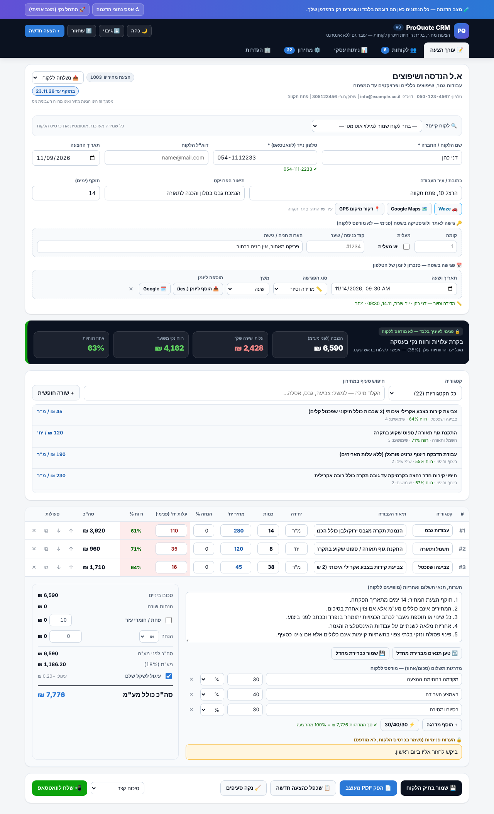
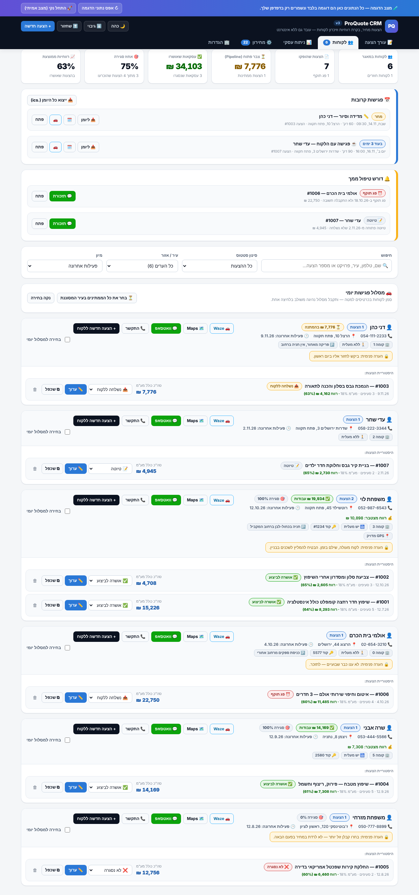
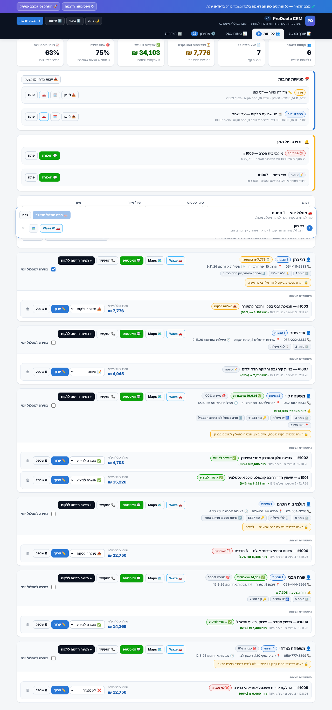
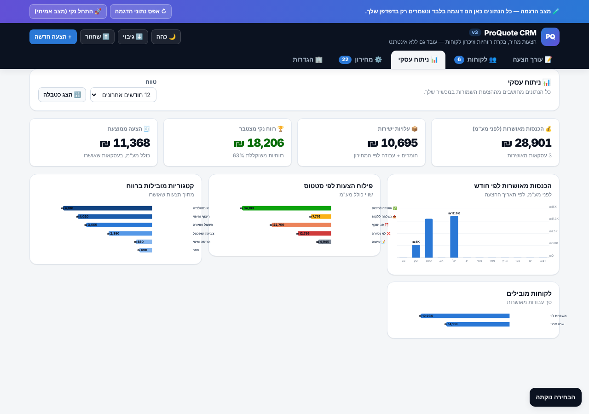
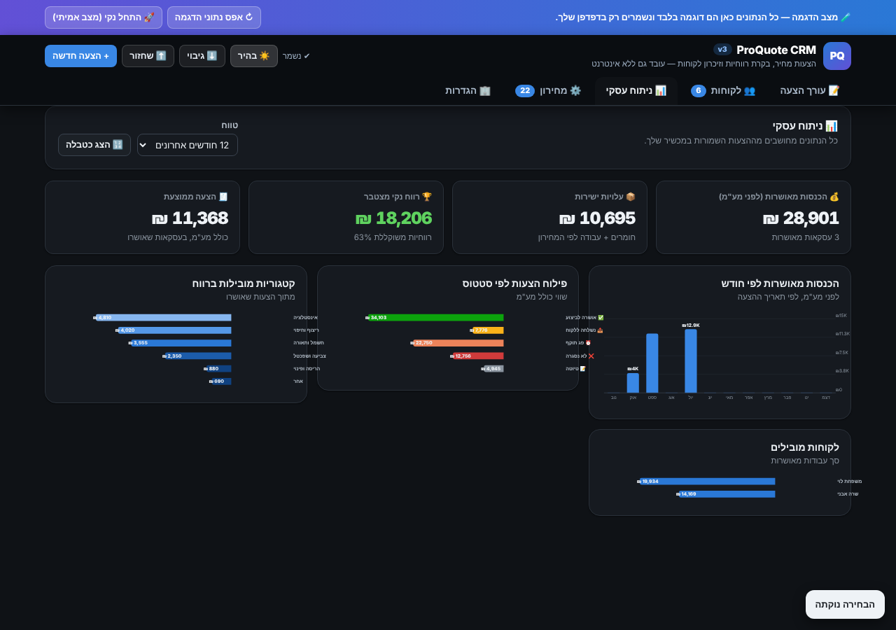
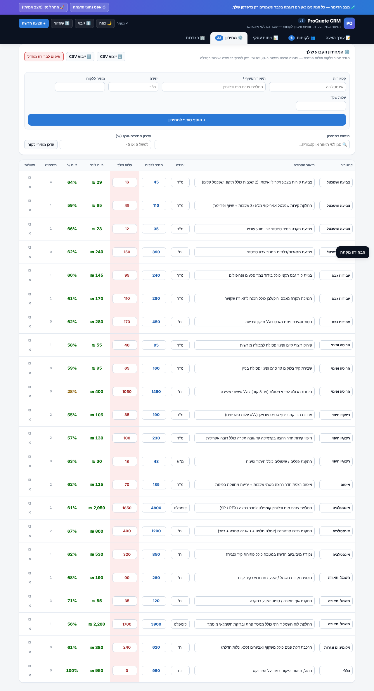
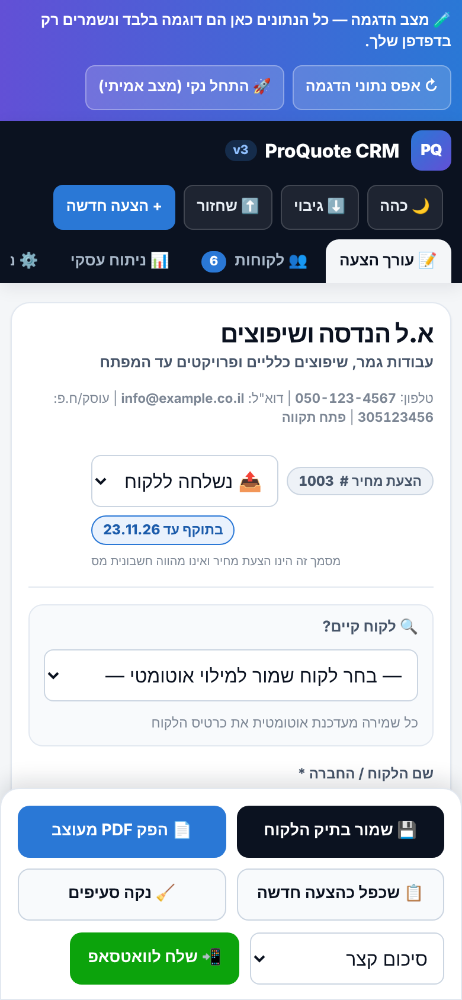
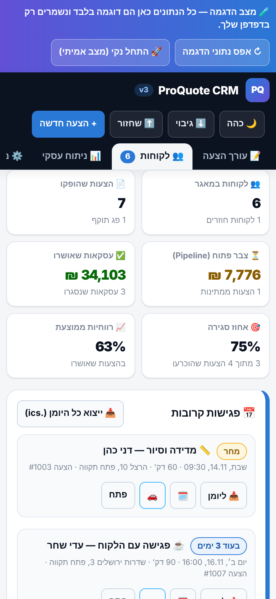
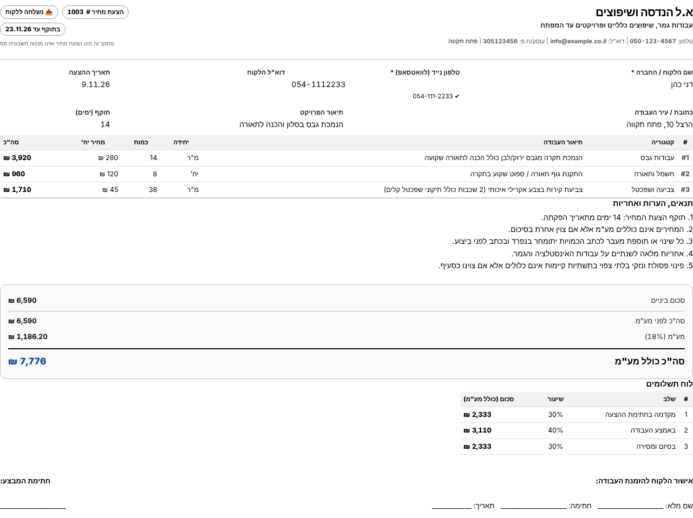

<div dir="rtl">

# ProQuote CRM

**מחשבון הצעות מחיר, בקרת רווחיות וניהול לקוחות לבעלי מקצוע — קובץ HTML אחד, ללא שרת, ללא תלויות, עובד אופליין.**

[](https://shovalnaor.github.io/proquote-crm/?demo=1)
[](LICENSE)


קבלן שיפוצים עומד בדירה של לקוח, בלי מחשב ולפעמים בלי קליטה, וצריך לתת מחיר עכשיו.
ProQuote נותן לו לבנות כתב כמויות ב-30 שניות מתוך מחירון אישי, **לראות את הרווח הנקי שלו בזמן אמת בזמן שהוא מתמחר**,
להפיק PDF מעוצב, לשלוח ללקוח בוואטסאפ — ולנווט לאתר הבא ברשימה.

> ### 🚀 [לכניסה להדגמה החיה (עם נתוני דוגמה)](https://shovalnaor.github.io/proquote-crm/?demo=1)
> ההדגמה טוענת 7 הצעות מחיר ו-6 לקוחות לדוגמה כדי שאפשר יהיה לשחק עם כל המסכים.
> הנתונים נשמרים **רק בדפדפן שלך** במפתח אחסון נפרד, ולא נוגעים בשום מידע אמיתי.
> לכניסה למצב נקי: [ללא `?demo=1`](https://shovalnaor.github.io/proquote-crm/).

---

## תוכן עניינים

- [צילומי מסך](#צילומי-מסך)
- [סנכרון יומן ושימוש בנייד](#סנכרון-יומן-ושימוש-בנייד)
- [יכולות](#יכולות)
- [למה קובץ אחד בלי תלויות](#למה-קובץ-אחד-בלי-תלויות)
- [הרצה מקומית](#הרצה-מקומית)
- [ארכיטקטורה](#ארכיטקטורה)
- [מודל הנתונים](#מודל-הנתונים)
- [פרטיות ואחסון](#פרטיות-ואחסון)
- [תאימות דפדפנים](#תאימות-דפדפנים)
- [מגבלות ידועות](#מגבלות-ידועות)
- [רישיון](#רישיון)

---

## צילומי מסך

### עורך הצעת המחיר — רווחיות בזמן אמת
כל שינוי בכמות או במחיר מעדכן מיד את הרווח הנקי, את אחוז הרווחיות ואת הרווח בכל שורה בנפרד.
כשהעסקה יורדת מתחת ליעד הרווחיות, המערכת אומרת באיזה מחיר כן מגיעים ליעד.



### מאגר לקוחות — היסטוריה, מעקב ופרטי גישה לאתר
כרטיס לקוח עם שווי מצטבר, אחוז סגירה, רווח מצטבר, קומה / מעלית / קוד שער, וכפתורי Waze, Maps, וואטסאפ והתקשרות.



### מסלול פגישות יומי
סימון כמה לקוחות מייצר מסלול נהיגה משולב ב-Google Maps, ורשימה ממוספרת עם Waze לכל תחנה בנפרד.



### ניתוח עסקי
הכנסות מאושרות לפי חודש, פילוח צבר לפי סטטוס, הקטגוריות הרווחיות ביותר והלקוחות המובילים — גרפי SVG שנכתבו ידנית, ללא ספריית גרפים.



### מצב כהה


### המחירון הקבוע
עריכה ישירה בטבלה, רווח ואחוז רווחיות לכל סעיף, ספירת שימושים, ייבוא/ייצוא CSV ועדכון מחירים גורף באחוזים.



### בטלפון — iPhone ו-Android
טבלת הסעיפים הופכת לכרטיסים, סרגל הפעולות נדבק לתחתית המסך, וכל שדה הוא לפחות 44px (ובגופן 16px, כדי ש-iOS לא יזום בכל לחיצה).

<p>


</p>

### ההצעה כפי שהלקוח מקבל אותה (PDF)
כל המידע הפנימי — עלויות, רווח, הערות פנימיות ופרטי גישה — נעלם מהמסמך המודפס.



---

## סנכרון יומן ושימוש בנייד

### 📅 פגישות שעוברות ליומן של הטלפון
לכל הצעת מחיר אפשר לקבוע **פגישה בשטח** — מדידה וסיור, תחילת עבודה, מסירה או פגישה עם הלקוח — ולשלוח אותה ליומן:

- **קובץ `.ics` תקני (RFC 5545)** שנבנה בדפדפן עצמו, בלי שרת ובלי שירות חיצוני. הוא נפתח ישירות ב**יומן של אייפון**, ב**יומן של אנדרואיד**, ב-Google Calendar וב-Outlook — זהו הפורמט שכל היומנים מדברים.
- **כפתור Google Calendar** שפותח את האירוע מוכן למילוי (נוח במיוחד באנדרואיד).
- **תזכורת אוטומטית שעתיים לפני** (`VALARM`), ואם יש נקודת GPS היא נשמרת באירוע כ-`GEO` — היומן יודע איפה זה.
- גוף האירוע נושא את מה שבאמת צריך בשטח: מספר ההצעה, הסכום, טלפון הלקוח, הקומה, קוד הכניסה, הערות החניה וקישור Waze לנקודה המדויקת.
- **ייצוא כל היומן בקובץ אחד** מלשונית הלקוחות: כל הפגישות + תזכורות מעקב להצעות שלא נענו + תאריכי פקיעת תוקף, כאירועי יום שלם.

הטקסט בקובץ מקופל ל-75 אוקטטים לפי התקן — בלי זה יומנים קפדניים נשברים על עברית.

### 📱 מותאם לטלפון
- טבלת הסעיפים הופכת בטלפון ל**כרטיסים** עם תוויות, במקום טבלה רחבה שאי אפשר לקרוא
- סרגל פעולות דביק בתחתית (שמירה / PDF / וואטסאפ) + תמיכה ב-`safe-area` של מסכי iPhone עם נאטץ'
- שדות בגופן 16px — מונע את הזום האוטומטי של iOS בכל לחיצה על שדה
- כל יעד לחיצה הוא לפחות 44px, ואין גלילה אופקית באף מסך (נבדק ב-390px וב-360px)
- `apple-touch-icon` + meta-tags של PWA: **"הוסף למסך הבית"** באייפון ובאנדרואיד נותן אפליקציה במסך מלא עם אייקון משלה

---

## יכולות

### 💰 תמחור ורווחיות
- מחירון אישי עם **מחיר ללקוח ועלות פנימית** לכל סעיף
- רווח ואחוז רווחיות **לכל שורה** ולעסקה כולה, בזמן אמת
- יעד רווחיות אישי + חישוב המחיר שנדרש כדי להגיע אליו
- הנחה לכל שורה, תוספת פחת באחוזים, הנחה כללית ב-₪ או ב-%, עיגול לשקל שלם עם הצגת ההפרש
- **מע"מ מוקפא לכל מסמך** — שינוי שיעור המע"מ בהגדרות לא משנה רטרואקטיבית הצעות היסטוריות

### 👥 CRM
- כרטיס לקוח אוטומטי מכל הצעה שנשמרת, עם איחוד לפי טלפון
- שווי עבודות מאושרות, רווח מצטבר, אחוז סגירה וצבר פתוח
- זיהוי לקוח חוזר בזמן ההקלדה, עם מילוי פרטים אוטומטי מההצעה הקודמת
- תוקף הצעה והתראת פקיעה, ורשימת **"דורש טיפול ממך"**: הצעות שנשלחו ולא נענו, טיוטות תקועות והצעות שפג תוקפן
- חיפוש, סינון לפי סטטוס ולפי עיר, ומיון לפי פעילות / שווי / כמות הצעות / שם

### 📅 יומן ופגישות
- פגישה בשטח לכל הצעה, עם סוג פגישה ומשך
- ייצוא `.ics` תקני לאייפון/אנדרואיד/Outlook + קישור ישיר ל-Google Calendar
- רשימת "פגישות קרובות" ב-CRM עם ניווט ויומן בלחיצה
- ייצוא יומן מלא: פגישות + תזכורות מעקב + תאריכי פקיעת תוקף

### 🚗 ניווט ולוגיסטיקת שטח
- קישורי ניווט ישירים ל-**Waze, Google Maps ו-Apple Maps** — ללא מפתח API וללא ספריית מפות
- **נעילת נקודת GPS** מהשטח בלחיצה אחת (`navigator.geolocation`) — פתרון לאתרי בנייה בלי שם רחוב
- פרטי גישה לאתר: קומה, מעלית, קוד שער והערות חניה — נשמרים בין הצעות חוזרות ומוצגים בכרטיס הלקוח
- **מסלול פגישות יומי**: בחירת כמה לקוחות → מסלול משולב ב-Google Maps + Waze לכל תחנה בנפרד

### 📄 מסמכים ושיתוף
- PDF מעוצב דרך מנוע ההדפסה של הדפדפן: A4, כותרות טבלה שחוזרות בין עמודים, בלוק חתימות, לוח תשלומים
- כל המידע הפנימי מוסתר אוטומטית מהמסמך שמגיע ללקוח
- הודעת וואטסאפ מוכנה — סיכום קצר או פירוט סעיפים מלא
- לוח תשלומים (מקדמה / אמצע / מסירה) עם ולידציה שהמדרגות מסתכמות ל-100%

### 🧰 כלי עבודה
- גיבוי ושחזור JSON מלא, ייצוא הצעות ומחירון ל-CSV (עם BOM, נפתח נכון באקסל בעברית)
- מצב כהה, קיצורי מקלדת, Undo לכל מחיקה, דחיסת לוגו אוטומטית ב-canvas
- הגירה אוטומטית מנתוני גרסאות קודמות של הכלי

---

## למה קובץ אחד בלי תלויות

ההחלטה הארכיטקטונית המרכזית כאן היא **אפס רשת בזמן ריצה**:

| החלטה | הסיבה |
|---|---|
| אין CDN (לא Tailwind, לא ספריית גרפים, לא jQuery) | קבלן במרתף בלי קליטה מקבל אפליקציה מלאה, לא עמוד שבור |
| אין שרת ואין build | הקובץ נשלח בוואטסאפ, נשמר במסך הבית ועובד |
| אין API בתשלום | הניווט עובד ב-deep links; המיקום מגיע מה-GPS של המכשיר עצמו |
| אין מסד נתונים | `localStorage` + גיבוי JSON מפורש, בלי חשבון ובלי הרשמה |

המחיר: אין סנכרון בין מכשירים, ואין גיאוקודינג של כתובת לקואורדינטות. שני הפערים האלה מתועדים למטה.

---

## הרצה מקומית

אין התקנה, אין `npm install`, אין build:

```bash
git clone https://github.com/Shovalnaor/proquote-crm.git
cd proquote-crm
# פשוט לפתוח את הקובץ בדפדפן:
open index.html        # macOS
start index.html       # Windows
xdg-open index.html    # Linux
```

להדגמה עם נתוני דוגמה, להוסיף `?demo=1` לכתובת.

**בנייד:** לפתוח את ההדגמה בדפדפן ← "הוסף למסך הבית". מכאן זה מתנהג כמו אפליקציה.
שימו לב ש-`navigator.geolocation` דורש HTTPS, ולכן נעילת ה-GPS עובדת דרך הקישור של GitHub Pages
(או `localhost`), אבל לא מקובץ `file://`.

---

## ארכיטקטורה

```
index.html  (~2,500 שורות)
├── <style>   טוקני עיצוב (CSS variables) · תמות בהיר/כהה · RTL · גיליון הדפסה ל-A4
├── <body>    5 לשוניות: עורך · לקוחות · ניתוח עסקי · מחירון · הגדרות
├── <script>  ליבה:   state · מיגרציות · מנוע כספי · עורך ההצעה · ניווט ו-GPS
└── <script>  מודולים: CRM · מסלול יומי · גרפים · מחירון · הגדרות · ייצוא · חיווט
```

עקרונות שנאכפו לאורך הקוד:

- **מקור אמת אחד.** `S` הוא כל מצב האפליקציה; כל רינדור נגזר ממנו, ואין מצב שחי ב-DOM בלבד.
- **פונקציית חישוב טהורה אחת.** `calc(quote)` מחזירה את כל המספרים — והיא זו שמשרתת את העורך, את ה-CRM, את הגרפים, את הוואטסאפ ואת ה-CSV. אין שני מקומות שמחשבים מע"מ.
- **אין `innerHTML` על קלט משתמש.** כל רינדור של נתוני לקוח נעשה דרך `el()` ו-`textContent`. מחרוזות שכן נכנסות ל-SVG עוברות `esc()`.
- **רינדור ממוקד.** הקלדה בשורת סעיף מעדכנת את התא ואת הסיכומים בלבד, בלי לבנות מחדש את הטבלה — כדי לא לאבד מיקוד וסמן.
- **כסף בלי מספרים צפים שבורים.** כל שלב מעוגל לאגורות (`r2`) בסדר קבוע: שורה ← הנחת שורה ← פחת ← הנחה ← מע"מ ← עיגול.

### נבדק
הקובץ נבדק ב-Chromium דרך Playwright: החישובים אומתו מקצה לקצה (כולל הנחת שורה + פחת + הנחה + מע"מ + עיגול),
נבדקה השמירה ב-`localStorage` לאחר רענון, נבדקו קישורי הניווט עם ובלי נקודת GPS, ונבדק שפרטי העלות והגישה
**אינם** מופיעים בתצוגת ההדפסה. קובץ ה-`.ics` נבדק ברמת הבייטים: CRLF תקני, קיפול שורות מתחת ל-75 אוקטטים
ומבנה `VEVENT`/`VALARM` תקף. הפריסה נבדקה ב-390px (iPhone) וב-360px (Android) — אפס גלילה אופקית ואפס שגיאות קונסול.

---

## מודל הנתונים

```js
quote = {
  id, quoteNum, status,            // draft | sent | approved | rejected
  clientName, clientPhone, clientEmail,
  clientAddress, clientCity,        // העיר נגזרת אוטומטית מהכתובת
  clientCoords: { lat, lng } | null,// נקודת GPS מדויקת מהשטח
  siteAccess: { floor, elevator, code, parking },
  meeting: { at, durationMin, kind },// פגישה בשטח → ICS / Google Calendar
  projectTitle, quoteDate, validityDays,
  vatRate,                          // מוקפא ברגע השמירה
  wasteEnabled, wastePct,
  discountMode, discountVal,        // 'amount' | 'pct'
  roundTotal,
  notes, internalNotes,             // internalNotes לא מודפס אף פעם
  milestones: [{ label, mode, val }],
  items: [{ category, desc, unit, qty, price, cost, discPct }]
}
```

כרטיס הלקוח אינו ישות נפרדת — הוא נגזר מההצעות ב-`aggregateClients()`, עם איחוד לפי מספר טלפון.
כך אין שני מקורות אמת שיכולים לסתור זה את זה.

---

## פרטיות ואחסון

- **כל המידע נשאר במכשיר.** אין שרת, אין אנליטיקס, אין בקשת רשת אחת בזמן ריצה.
- המידע יושב ב-`localStorage` (כ-5MB). מחיקת היסטוריית הדפדפן תמחק אותו — לכן יש גיבוי JSON בלחיצה, ומומלץ להוריד גיבוי פעם בשבוע.
- לוגו שמועלה נדחס ב-`canvas` לפני השמירה, כדי שלא ימלא את מכסת האחסון.
- לחיצה על Waze או Google Maps פותחת אתר חיצוני בלשונית חדשה — זו הבקשה היחידה שיוצאת החוצה, וגם היא רק ביוזמת המשתמש.

---

## תאימות דפדפנים

| דפדפן | מצב |
|---|---|
| Chrome / Edge (מחשב ונייד) | נבדק ✔ |
| Safari (iOS ו-macOS) | נבדק ב-390px ✔ · `beforeprint` מוגבל, ולכן יש גם מאזין `matchMedia('print')` |
| Chrome Android | נבדק ב-360px ✔ |
| Firefox | עובד |
| Internet Explorer | לא נתמך (הקוד משתמש ב-ES2020) |

---

## מגבלות ידועות

- **אין סנכרון בין מכשירים.** המידע חי במכשיר אחד. מעבר למכשיר אחר נעשה דרך קובץ גיבוי.
- **אין גיאוקודינג כתובת ← קואורדינטות.** זו החלטה מכוונת: גיאוקודינג דורש מפתח API בתשלום. במקום זה — או נעילת GPS חד-פעמית באתר, או ש-Waze/Google פותרים את הכתובת בעצמם.
- **Google Maps מגביל ל-10 תחנות** בקישור מסלול יחיד. מעבר לזה הממשק מודיע מפורשות כמה תחנות נשארו בחוץ.
- **זו הצעת מחיר, לא חשבונית.** אין כאן חשבוניות, קבלות או דיווח למע"מ, והמסמך נושא הערה מפורשת על כך.
- **היומן הוא ייצוא, לא סנכרון דו-כיווני.** הקובץ מוסיף אירועים ליומן; שינוי אירוע ביומן לא יחזור לאפליקציה. סנכרון אמיתי דורש שרת ו-OAuth — מה שסותר את העיקרון של אפס שרת.
- אין בדיקת תקינות של מספר עוסק מורשה.

---

## רישיון

[MIT](LICENSE) — חופשי לשימוש, לשינוי ולהפצה.

</div>

---

## English

**ProQuote CRM** — a single-file, zero-dependency, offline-first quoting and CRM tool for contractors and tradespeople, built Hebrew-first with full RTL support.

One `index.html` (~2,500 lines), no build step, no server, no CDN, no paid API keys. It covers quote building from a personal price book, live profit-margin control, an auto-derived client CRM with follow-up alerts, hand-written SVG analytics, field navigation (Waze / Google Maps / Apple Maps deep links + one-tap GPS pinning + multi-stop daily route planning), and a print stylesheet that produces a clean A4 PDF with all internal cost data stripped out.

It also exports standards-compliant **RFC 5545 `.ics` calendar files** generated entirely in the browser — site meetings, follow-up reminders and quote-expiry dates drop straight into the iPhone Calendar, Android Calendar, Google Calendar or Outlook, with a 2-hour alarm and a `GEO` pin. The layout is phone-first: the line-items table becomes cards, actions stick to the bottom, inputs are 16px (no iOS zoom-on-focus), and "Add to Home Screen" gives a full-screen app on both platforms.

**[→ Live demo](https://shovalnaor.github.io/proquote-crm/?demo=1)** · All data stays in the browser's `localStorage`; nothing is ever sent anywhere.
